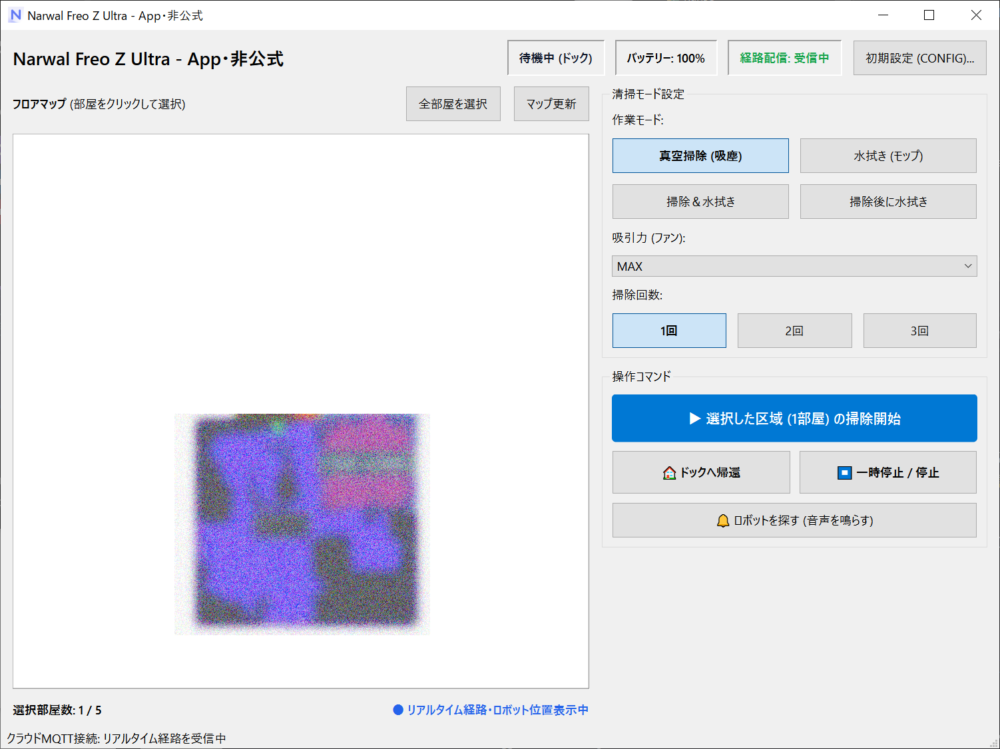
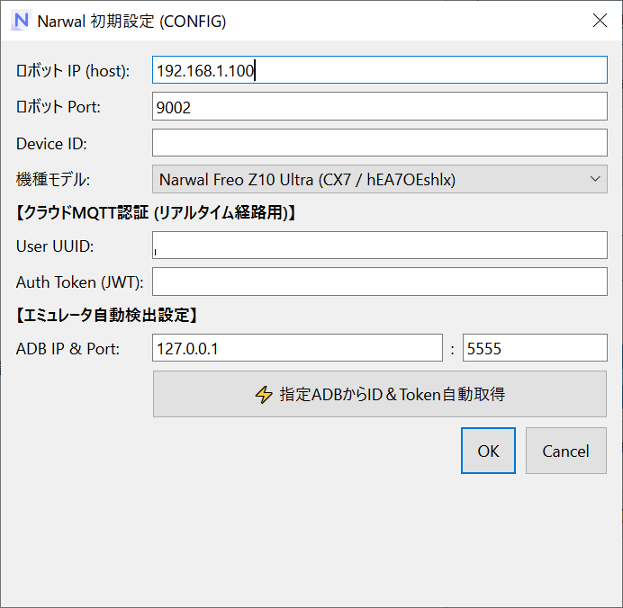

# Narwal Freo Z Ultra - App・非公式

Narwal 製ロボット掃除機（Freo / Freo Z Ultra 等）を Windows パソコンから直接操作・確認できるデスクトップアプリケーションです。

---

## 🚀 起動方法

1. 配布された ZIP ファイル（`NarwalController_Portable.zip`）を右クリックし、「すべて展開」で任意のフォルダに解凍します。
2. フォルダ内の **`NarwalQtController.exe`** をダブルクリックして起動します。

---

## ⚙ 初期設定（初回起動時のみ）

アプリ画面右上の **「初期設定 (CONFIG)...」** ボタンを押して設定画面を開きます。

手動入力のほか、**Android エミュレータ（LDPlayer / BlueStacks / NoxPlayer / Android Studio 等）と連携してワンクリックで認証情報を自動抽出** できます。

### 1. 各項目の説明

| 設定項目 | 内容・例 |
| :--- | :--- |
| **ロボット IP (host)** | ロボット掃除機本体のローカル IP アドレス（※内部 IP のみ入力可能。例: `192.168.1.50`） |
| **ロボット Port** | 通常は既定値 `3000` のままで構いません |
| **Device ID** | ロボット本体の固有 Device ID（32桁英数字） |
| **機種モデル** | お使いの機種を選択（Freo Z Ultra / Freo 等） |
| **User UUID (Cloud)** | Narwal クラウド連携用ユーザー識別子（UUID形式） |
| **Auth Token (JWT)** | クラウド MQTT 接続用の認証トークン（リアルタイム走行位置の受信用） |
| **ADB IP & Port** | Android エミュレータの ADB 接続先（既定値: `127.0.0.1:5555`） |

> [!TIP]
> - 設定内容はアプリと同じフォルダに `narwal.ini` として自動保存されます。次回以降は再入力不要です。
> - ロボットの IP アドレスには、安全のため家庭内 LAN のプライベート IP（`192.168.x.x`、`10.x.x.x` 等）のみ入力可能です。

---

### 📱 Android エミュレータからの自動取得手順

Narwal アプリ内の認証情報（`Device ID` および `Auth Token`）は、PC 上で Android エミュレータを実行していれば **「⚡ 指定ADBからID＆Token自動取得」** ボタンから一発で取得できます。

#### 【ステップ 1】エミュレータの準備
1. お好みの Android エミュレータ（LDPlayer, BlueStacks, NoxPlayer, Android Studio 等）を起動します。
2. エミュレータ内の Google Play ストアから公式 **「Narwal」アプリ（`com.narwal.pita_global`）** をインストールし、ログインします。
3. エミュレータの設定で **「ROOT権限」** を有効化します（アプリ内の認証キャッシュを読み取るために必要です）。
4. エミュレータの ADB デバッグポートを確認します。
   - **LDPlayer**: 通常 `127.0.0.1:5555`
   - **NoxPlayer**: 通常 `127.0.0.1:62001`
   - **BlueStacks**: 通常 `127.0.0.1:5555` または設定画面の「高度な設定」記載のポート番号
   - **Android Studio AVD**: 通常 `127.0.0.1:5554`

#### 【ステップ 2】ワンクリック自動取得
1. 本アプリの初期設定ダイアログを開きます。
2. 「ADB IP & Port」にエミュレータの接続先（例: `127.0.0.1:5555`）を入力します。
3. **「⚡ 指定ADBからID＆Token自動取得」** ボタンをクリックします。
4. 自動的に ADB 経由でエミュレータ内部に保存されている `Device ID` と最新の `Auth Token (JWT)` を検出し、入力欄へ自動入力されます。
5. 「保存して再接続」をクリックすると設定完了です。

---

## 📖 使い方

### 1. 状態の確認（画面上部）
- **ステータス**: ロボットが「待機中（ドック）」か「清掃中」か等を表示します。
- **バッテリー**: 本体のバッテリー残量をパーセントで表示します。
- **経路配信**: 「受信中」と表示されている間、マップ上にロボットの現在地アイコンと走行ラインがリアルタイム描画されます。

### 2. 清掃モードを選ぶ（画面右側パネル）
- **作業モード**:
  - `真空掃除 (吸座)`: 吸引のみ
  - `水拭き (モップ)`: モップ掛けのみ
  - `掃除 & 水拭き`: 吸引とモップを同時に実行
  - `掃除後に水拭き`: 先に吸引掃除を行い、その後に水拭き
- **吸引力 (ファン)**: `弱` / `標準` / `強` / `MAX` から選択
- **掃除回数**: `1回` / `2回` / `3回` から選択

### 3. 掃除したい部屋を選ぶ（マップ操作）
- **部屋をクリック**: 掃除したい部屋をクリックすると枠線が付き、選択状態になります（再度クリックで解除）。
- **全部屋を選択**: 間取り全体のすべての部屋を一括選択します。
- **マップ更新**: 間取り図を最新の状態に再読み込みします。

### 4. 指示を出す（操作ボタン）
- **「▶ 選択した区域 (N部屋) の掃除開始」**: 選択した部屋の清掃をスタートします。
- **「■ 一時停止 / 停止」**: 動作中の掃除を一時停止・終了します。
- **「⌂ ドックへ帰還」**: 掃除を終了し、充電ステーション（ドック）へ戻します。
- **「🔔 ロボットを探す」**: ロボット本体から確認音声を鳴らして場所を知らせます。

---

## ⚠️ 注意事項
- 本アプリは公式アプリ（Narwal 社）の製品ではなく、有志による非公式ツールです。
- 保存される `narwal.ini` にはお客様のアカウント認証情報が含まれますので、他人へ渡したり公開場所に投稿しないようご注意ください。
